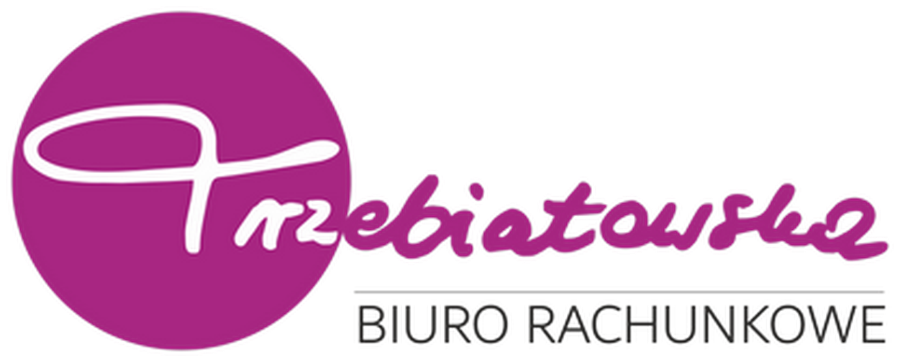

# 🏢 Biuro Rachunkowe Trzebiatowska – Nowy Serwis WWW

Nowoczesny, responsywny i zoptymalizowany pod konwersję serwis internetowy dla **Biura Rachunkowego Katarzyny Trzebiatowskiej** (Gdańsk Przymorze, ul. Piastowska 89).



## 📌 Najważniejsze Cechy Projektu
* **12 w pełni zakodowanych podstron** (w tym dedykowana wersja ukraińska `ua.html` oraz pełen zestaw podstron ofertowych, certyfikatów, procesu i kontaktu).
* **Wyeksponowane oficjalne logo i dopasowana paleta barw:** Główny akcent `#a82682` (fuksjowa purpura / śliwka wyciągnięta z sygnetu logo), powiększone i wyraźnie wyeksponowane logo w nagłówku.
* **Wielojęzyczność (PL / UA):** Przełącznik językowy w Topbarze i menu nawigacyjnym, z dedykowaną podstroną dla przedsiębiorców z Ukrainy.
* **Autentyczny kalkulator stawek netto:** Zgodny z matrycą cenową p. Katarzyny (JDG od 350 zł, Spółki od 950 zł).
* **Akademia LTCA & Wsparcie byłego Naczelnika Urzędu Skarbowego:** Zwiększone bezpieczeństwo zarządów i właścicieli firm.
* **Certyfikowane podpisy kwalifikowane Certum:** Współpraca ze Spółką Certland ([certland.pl](http://certland.pl/)) – sprzedaż i weryfikacja tożsamości na miejscu w biurze.
* **Gotowość na JPK_PD (od 2027 r.) i KSeF:** Pełne wsparcie technologiczne na oprogramowaniu InsERT (Rewizor / Rachmistrz nexo).
* **Wzorowa typografia:** Eliminacja wiszących spójników („sierotek”) w całym tekście (`&nbsp;` oraz `text-wrap: pretty; text-wrap: balance;`).
* **Lokalne SEO Gdańsk Przymorze:** Ujednolicony adres (ul. Piastowska 89), metatagi oraz dane strukturalne Schema.org (`AccountingService` w JSON-LD).

## 🚀 Jak uruchomić projekt lokalnie?
Projekt nie wymaga żadnych instalacji ani kompilacji. Działa od razu po pobraniu:

### Opcja 1: Bezpośrednio w przeglądarce
Kliknij dwukrotnie w plik `index.html`.

### Opcja 2: Lokalny serwer (opcjonalnie)
```bash
# Python:
python -m http.server 8080

# lub Node.js:
npx serve
```
Otwórz w przeglądarce adres `http://localhost:8080`.

## 📁 Struktura Plików
```
biuro-trzebiatowska/
├── index.html                  # Strona Główna (Hub, Kalkulator, FAQ)
├── ua.html                     # Wersja ukraińska dla przedsiębiorców z Ukrainy
├── o-biurze.html               # 18 lat doświadczenia, firma rodzinna, LTCA, b. naczelnik US
├── certyfikaty.html            # Licencja MF 28310, polisa Lloyd's, LTCA, Certum/Certland
├── ksiegowosc-jdg.html         # Ryczałt, KPiR, B2B, JPK_PD 2027 (InsERT)
├── pelna-ksiegowosc-spolki.html# Księgi handlowe, e-KRS, CIT, JPK_CIT 2027
├── kadry-i-place.html          # Płace, akta osobowe, pełna tajemnica wynagrodzeń
├── ksef.html                   # Wdrożenie KSeF oraz przygotowanie do JPK_PD 2027
├── rejestracja-firmy.html      # Pomoc przy rejestracji firmy (darmowa 1. konsultacja)
├── jak-pracujemy.html          # Standardy pracy (dokumenty do 5-7 dnia, weryfikacja sprzedaży i kosztów)
├── opinie.html                 # Referencje biznesowe (Sosnowski Sp. k., IMP PAN) i oceny Google
├── kontakt.html                # Dojazd, mapa, bezpośrednie telefony, NIP
├── DOKUMENTACJA_I_HISTORIA_ROZMOWY.md # Pełny raport, brief, wycena i korespondencja
├── assets/
│   ├── css/
│   │   └── style.css           # Dodatkowe style, typografia, estetyka logo
│   ├── js/
│   │   └── main.js             # Menu mobilne, cennik p. Katarzyny, FAQ, formularze
│   └── img/
│       ├── logo-default.png    # Oficjalne logo biura (wysoka rozdzielczość)
│       ├── logo-transp.png     # Logo z przezroczystym tłem
│       └── favicon.png         # Sygnet z literą "T"
```

---
© 2026 Biuro Rachunkowe Trzebiatowska. Projekt przygotowany przez Mchabov.
